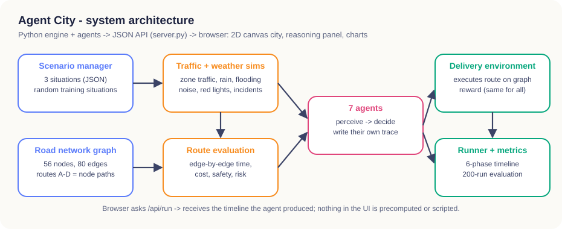

# Architecture and design

## 1. Why the project was rebuilt

The previous version was a generic admin dashboard (cards, forms and tables) with a decorative map. In this version:

- **The map is the simulation.** The city is drawn from the same road-network graph that the engine uses to compute times, costs and risks.
- **The rider is the execution.** The rider moves edge by edge with the exact timings the environment produced, including red lights and incidents.
- **The explanations are the agents' own traces.** Every agent writes its reasoning while it decides, and the dashboard only displays it.
- **Each architecture is a separate class** with a genuinely different mechanism: rules, state, goal search, utility, Q-learning, task scheduling, or context classification.

The old code is archived in `../backup_previous_implementation_2026-10-11.zip`.

## 2. System overview



```
data/scenarios.json ──► Scenario manager ─┐
engine/city.py (graph) ──────────────────┼─► DeliveryEnvironment ──► percepts ──► Agent.perceive()
engine/world.py (traffic, weather,        │                                      Agent.decide()  ──► Decision + trace
                 route evaluation)  ──────┘   execute(route) ◄───────────────────────────┘
                                              │ edge-by-edge trip, events, reward
sim/runner.py ── builds the 6-phase timeline ─┴─► server.py (JSON) ─► browser (canvas city + reasoning panel)
sim/runner.compare + engine/metrics ── 200 runs per decision, same seeds for all agents ─► Compare view, results/
```

| Component | File | Responsibility |
|---|---|---|
| Road network | `engine/city.py` | Streets → nodes and edges (length from geometry, speed, safety, zone, flooding); routes A–D as node paths; path validation |
| Traffic simulator | `engine/world.py` (`Traffic`) | Traffic level per zone, plus random speed variation per trip |
| Weather simulator | `engine/world.py` (`Weather`) | Rain slows roads, floods flood-prone roads and lowers safety; night lowers safety |
| Route evaluation engine | `engine/world.py` (`evaluate_route`) | Edge-by-edge expected time, red-light wait, cost, safety and incident risk |
| Scenario manager | `engine/scenarios.py` | Loads the 3 situations; generates random training situations |
| Delivery environment | `engine/environment.py` | Percept stream (two feeds, sensors can be offline), execution, reward |
| Performance metrics | `engine/metrics.py` | 200-run evaluation with common random numbers |
| Agent decision engine | `agents/*.py` | Seven architectures sharing `perceive` → `decide`, each with its own trace |
| Simulation event log / timeline | `sim/runner.py` | Observe → Reason → Decide → Act → Respond → Result steps, stored for replay |
| Diagrams | `sim/diagrams.py` | SVG architecture diagrams from each agent's `diagram` description |
| API | `server.py` | `/api/init`, `/api/run`, `/api/compare`, `/api/compare_all`, `/api/train`, `/api/test_policy`, `/api/diagram/*.svg` |
| Front end | `web/js/city3d.js`, `panel.js`, `charts.js`, `app.js` | 3D city with HTML labels, step widgets, SVG charts, controller and views |

## 3. Technology choice

| Need | Choice | Reason |
|---|---|---|
| Correct, testable agents | Python 3 classes, standard library only | Readable in a viva; `pytest` runs the whole suite in about 2 s; no heavy dependencies |
| Serve the app locally | `http.server.ThreadingHTTPServer` | No installation; one command (`python app.py`) |
| Game-like city, smooth motion | three.js (r128, stored offline) isometric scene in `city3d.js` | Low-poly towers, shops, houses, trees, street lamps and moving cars with shadows; a camera that follows the rider; night and rain lighting |
| Charts and diagrams | Hand-written SVG | Sharp at any size, hover tooltips, no CDN needed, works offline |
| UI framework | None (ES modules) | The UI is one page with four views; a framework would add a build step without adding capability |

Alternatives considered: React/Next.js (build step, no benefit for a 3D scene), Phaser or PixiJS (2D-only engines, while the isometric toy-city look needs real 3D blocks and shadows), Flask or FastAPI (an extra dependency for six endpoints).

## 4. Design direction (UI)

- **Look:** a dark "night-sky" game interface (indigo panels, sunny-yellow accent, mint "go" button, rounded chunky controls in the Fredoka display font) around a bright, colourful isometric low-poly 3D city (brick and glass towers, colourful warehouses and houses, as in a toy-city game). The city has striped shop awnings, pitched roofs, parks with ponds, a canal with bridges, a toll plaza, zebra crossings and traffic lights.
- **Camera:** shows the whole city while the agent observes and reasons, then zooms in and follows the rider during the delivery; the user can switch to the whole-city view, move the view with the ◀ ▲ ▼ ▶ buttons, the arrow keys (mouse over the map), dragging or a sideways touchpad swipe, and zoom with ＋/－ or the scroll wheel.
- **Situational atmosphere:** a clear afternoon sky, a rush-hour sunset light, and a rainy night (darkness, street-lamp glow, lit windows, car headlights, falling rain, puddles on flooded lanes).
- **Map feedback driven by the agent's trace:** routes being checked pulse, rejected routes fade with ✕, routes the agent cannot see turn grey with ?, and the chosen route glows with moving dashes. A thought bubble above the rider shows the current reasoning step.
- **Layout:** left mission control (situation, agent, controls, learning), centre city with a phase banner and a step timeline, right "inside the agent's mind" panel (phase stepper, current step widget, execution trace).
- **Responsive:** three columns on desktop, stacked panels below 1100 px, single column on phones.

## 5. Playback and reproducibility

- `/api/run` returns the full timeline at once: every reasoning step, every ride segment with start and end times, the environment response and the result. **Previous step** simply shows a stored step; nothing is recomputed.
- The animated delivery is execution #k of the same 200 seeded runs used for the statistics, so the animation and the numbers always agree (a test checks this).
- Every run creates a **fresh agent instance**. The learning agent receives a *copy* of the trained Q-table, so watching or switching agents never changes another agent's state or the benchmark (a test checks this).
