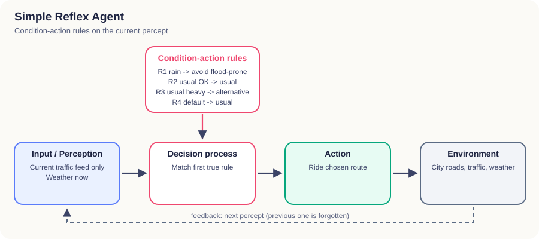
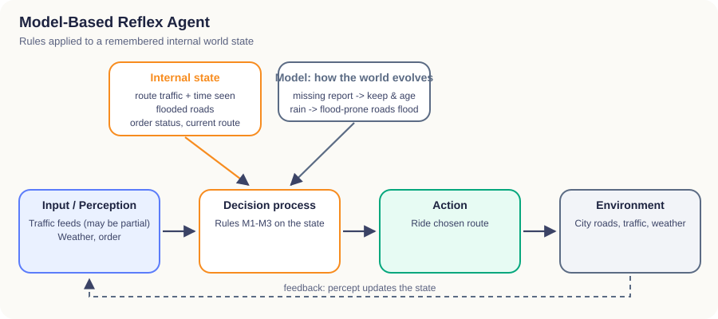
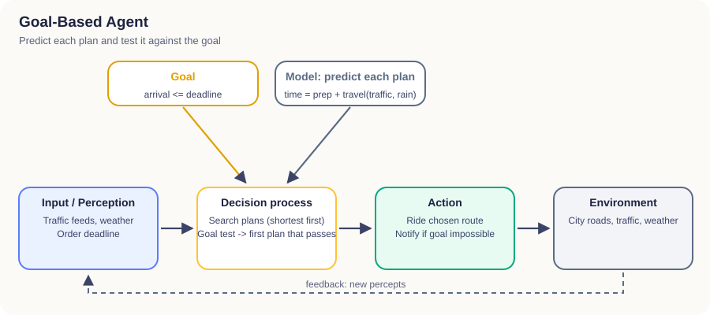
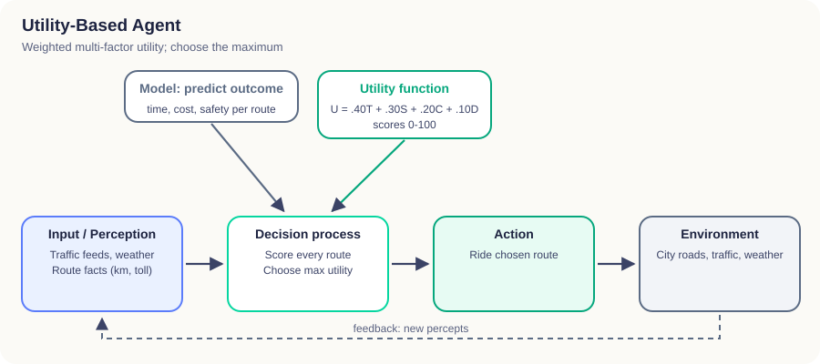
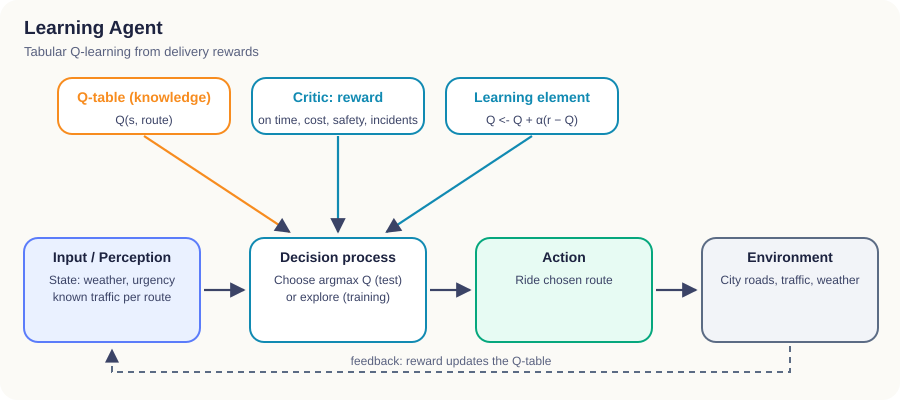
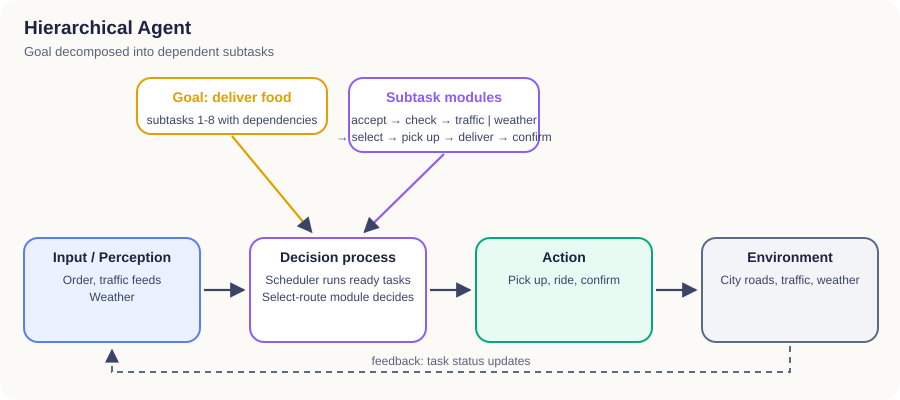
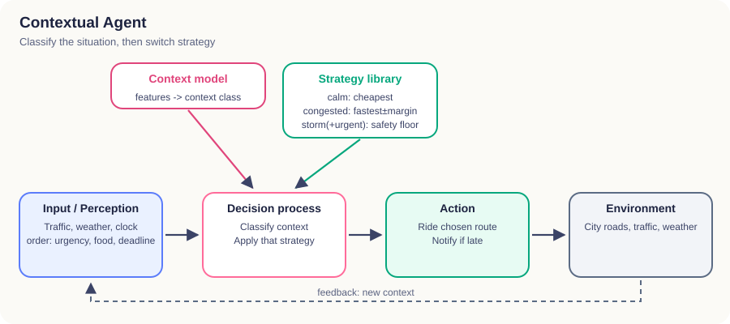

# Assignment 1: Smart Food Delivery Agent

| | |
|---|---|
| **Course** | Agent Based Modeling |
| **Assignment** | No. 1 (Group assignment) |
| **Student names** | Semal Fatima, M. Aryan |
| **Roll numbers** | L1F23BSAI0088 (Semal Fatima), L1F23BSAI0019 (M. Aryan) |
| **Section** | AG-1 |
| **Instructor** | Sir Zeeshan Hussain Chuhan |
| **Submission date** | 11 October 2026 |

> All data used in this project is simulated (fictional city, roads, orders and prices).

---

## 1. Objective

The assignment asks how changing an agent's architecture changes the way it uses information, makes decisions and selects actions in the **same** environment. We built one simulated food-delivery world and implemented seven single-agent architectures in it. We then tested every agent in the three required situations, using the same data and the same performance measure.

The implementation includes an interactive 2D dashboard (`python app.py`). In the dashboard, each agent's reasoning can be followed step by step while a rider drives the chosen route on the map.

## 2. The environment

### 2.1 City and road network

The city is a graph of **56 intersections (nodes)** and **80 road segments (edges)**. Each edge has a length, road type, speed limit, base safety, traffic zone and, for some roads, a tendency to flood. Four candidate routes connect the restaurant to the customer. Each route is a continuous path of edges, and the tests check this.

| Route | Road | Distance | Traffic lights | Toll | Floods in rain | Base safety |
|---|---|---|---|---|---|---|
| A | Main Boulevard (downtown) | 5.0 km | 4 | – | no | 0.80 |
| B | Canal Ring Road | 8.2 km | 2 | – | no | 0.87 |
| C | Old Town Lanes | 6.6 km | 0 | – | **yes** | 0.77 |
| D | Northern Expressway | 9.4 km | 0 | 3.0 CU | no | 0.90 |

### 2.2 Traffic, weather and execution

- **Travel time** of an edge = length / speed × 60 × traffic factor (light 1.0, normal 1.3, heavy 2.5) × weather factor (rain 1.2; flood-prone road in rain a further 1.6). Red lights add waiting time.
- **Safety** of an edge drops in rain (by up to 0.30 on the high-speed expressway), on flooded roads (−0.20), at night (−0.03) and in heavy traffic (−0.04).
- **Execution.** The environment drives the chosen route edge by edge with the *true* traffic. It adds random day-to-day variation (±10%), random red-light waits and a chance of an incident (3–7 minutes delay) that grows with low safety. The agent never sees this randomness in advance.

### 2.3 What the agent perceives

The agent receives two traffic feeds, one from 10 minutes earlier and one from now, together with the weather, the order (food, preparation time, deadline, urgency) and the map facts of each route. A sensor can be **offline**, in which case the latest feed has no report for that route.

### 2.4 Performance measure (the same for every agent)

```
reward = +10 if on time, otherwise −0.8 × minutes late (−5 more if the order is urgent)
         − 0.3 × cost − 15 × (1 − safety) − 10 if an incident happened
```

Each agent's decision is executed **200 times** with the same random seeds for every agent (common random numbers). Two agents that choose the same route therefore get identical results, and every difference between agents comes from their decisions.

## 3. The three test situations

| Situation | Conditions | What the agent sees | Ground truth (expected arrival) |
|---|---|---|---|
| **S1** Normal traffic + good weather (14:00) | all roads normal, clear, deadline 35 min | complete feeds | A 17.6, B 22.3, C 22.5, D 20.4 min: all on time |
| **S2** Heavy traffic + multiple routes (18:00) | downtown and expressway heavy, ring road **light**, lanes normal; deadline 30 min | **ring-road sensor offline now** (it was "light" 10 min ago) | A 31.1 (late), B **22.1**, C 24.5, D 26.9 min |
| **S3** Heavy traffic + rain + urgent (21:30, night) | downtown heavy, lanes **flooding**, expressway empty but slippery; deadline 23 min, urgent hot soup | complete feeds (downtown changed from normal to heavy) | A 31.9, B 24.4 (late), C 34.1, **D 20.9 (only on-time route, safety 0.67)** |

S3 contains the hard trade-off. The expressway (D) is the only route that meets the deadline, but it is the riskiest dry-road option at speed in the rain. The ring road (B) is safer and cheaper, but it will almost always be late.

## 4. The seven agents

Each agent is an independent Python class with the interface `perceive(percept)` → `decide()`. While deciding, each agent writes its own reasoning trace. The dashboard displays this trace, so the explanations are not scripted. The architecture diagrams are in `results/diagrams/` and on the dashboard's Architecture diagrams page. Each diagram follows *Input/Perception → Decision process → Action → Environment*, plus the component specific to that architecture.

### 4.1 Simple Reflex Agent


**Behaviour:** IF-THEN rules on the current percept only.
**Rules:** R1 IF raining THEN drop flood-prone routes. R2 IF the usual (shortest) route is light/normal THEN take it. R3 IF the usual route is heavy THEN take the first alternative reported light/normal. R4 otherwise take the usual route.
**Decisions:** S1 → A (R2). S2 → **C** (R3; it cannot see B because B's sensor is offline and it has no memory). S3 → **B** (R1 removes C, R3 picks B; it never checks the deadline, so it is late 81.5% of the time).

### 4.2 Model-Based Reflex Agent


**Behaviour:** keeps an internal state of traffic per route (with the time it was observed), flooded roads, order status and current route. A missing report keeps the remembered value, which ages and is forgotten after 30 minutes. The model marks flood-prone roads as flooded in rain. Its rules run on the state.
**Decisions:** S1 → A. S2 → **B** (it remembers "B light, seen at 17:50"). S3 → **D** (A heavy, C flooded; D has the lowest predicted arrival of the clear routes).

### 4.3 Goal-Based Agent


**Behaviour:** the goal is *arrival ≤ deadline*. It predicts each plan (shortest first), tests the goal, and takes the first plan that passes. If no plan can pass, it reports that the goal is unachievable, takes the least-late plan and notifies the customer. A test checks this fallback.
**Decisions:** S1 → A. S2 → **C** (A fails at 31.1 > 30; C passes at 24.5, so the search stops before B, which would have been better). S3 → **D** (the only plan that satisfies the goal).

### 4.4 Utility-Based Agent


**Behaviour:** U = 0.40·Time + 0.30·Safety + 0.20·Cost + 0.10·Distance. Each score is on a 0–100 scale: Time = 100 × fastest/this, Cost = 100 × cheapest/this, Distance = 100 × shortest/this, Safety = 100 × predicted safety.
**Decisions:** S1 → A (U 94.0). S2 → B (U 92.3 vs C 84.6). S3 → **B** (U 81.8 vs D 77.9). The fixed weights reward B's lower cost and higher safety, and the deadline is not a constraint. The agent shows in its trace that B is predicted to be late (24.4 > 23).

### 4.5 Learning Agent


**Behaviour:** tabular Q-learning. State = (weather, urgency, last known traffic report of A–D); actions = routes; reward = the performance measure. Each delivery is one episode, so Q(s,a) ← Q(s,a) + α(r − Q(s,a)), with α = max(0.02, 1/n). Training: 1500 episodes with ε-greedy exploration (ε 1.0 → 0.05); half of the episodes are the three situations and half are random situations. Testing: greedy policy (ε = 0) on separate seeds.
**Learning result:** the mean reward rose from −1.78 (first 150 episodes) to +0.65 (last 150). The learned greedy policy chooses the route with the highest true mean reward in all three situations, and the result is the same with training seeds 42, 7 and 123.
**Decisions:** S1 → **B**. It learned that the ring road's higher safety outweighs its extra cost, which the hand-written agents do not weigh this way. S2 → B. S3 → D.

### 4.6 Hierarchical Agent


**Behaviour:** the goal "deliver food" is split into 8 subtasks with dependencies: accept order → check order information → {evaluate traffic, check weather} → select route → pick up food → execute delivery → confirm delivery. A scheduler starts a task only when its prerequisites are complete; a test checks that it refuses otherwise. *Evaluate traffic* rejects heavy routes, *Check weather* rejects flooded routes, and *Select route* picks the cheapest on-time route (the fastest if urgent).
**Decisions:** S1 → A. S2 → B. S3 → D.

### 4.7 Contextual Agent


**Behaviour:** collects context (weather, night, time of day, urgency, heavy routes, missing reports, age of information, food type, deadline slack), classifies the situation, and switches strategy:

| Context | Strategy |
|---|---|
| Calm | cheapest route with ≥ 5 min slack |
| Congested | earliest arrival; +10% time margin for routes whose report is old |
| Urgent | earliest arrival |
| Storm | safest on-time route (safety ≥ 0.65) |
| Storm + urgent | safety floor 0.60 (+0.05 at night), then earliest arrival; notify the customer if late |

Spill-sensitive food (soup, drinks) also avoids flooded lanes.
**Decisions:** S1 (Calm) → A. S2 (Congested) → B (B 23.5 min including the stale-data margin, vs C 24.5). S3 (Storm + urgent) → D (A and C are below the safety floor; D arrives first).

## 5. Results

Seed 42, 200 runs per decision. Generated by `python run_experiments.py`; full tables are in `results/results_summary.md` and `results/results.csv`.

### S1: Normal traffic + good weather (deadline 35 min)

| Agent | Route | Mean time | Cost | Safety | On time | Reward |
|---|---|---|---|---|---|---|
| Simple Reflex, Model-Based, Goal-Based, Utility-Based, Hierarchical, Contextual | A | 17.68 | 2.75 | 0.798 | 100% | +5.99 |
| Learning | B | 22.44 | 4.11 | 0.868 | 100% | **+6.55** |

### S2: Heavy traffic + multiple routes (deadline 30 min)

| Agent | Route | Mean time | Cost | Safety | On time | Reward |
|---|---|---|---|---|---|---|
| Model-Based, Utility-Based, Learning, Hierarchical, Contextual | B | 22.49 | 3.81 | 0.865 | 99.5% | **+6.27** |
| Simple Reflex, Goal-Based | C | 24.69 | 3.82 | 0.763 | 98.5% | +4.73 |

### S3: Heavy traffic + rain + urgent delivery (deadline 23 min)

| Agent | Route | Mean time | Cost | Safety | On time | Reward |
|---|---|---|---|---|---|---|
| Model-Based, Goal-Based, Learning, Hierarchical, Contextual | D | 21.53 | 7.36 | 0.654 | 84.5% | **−1.11** |
| Simple Reflex, Utility-Based | B | 24.66 | 4.59 | 0.752 | 18.5% | −9.44 |

No agent is shown as on time when its delivery is late. In S3, even the best decision is late in 15.5% of the runs, because the deadline is very tight in a storm.

### Overall

| Agent | S1 | S2 | S3 | Mean reward |
|---|---|---|---|---|
| Simple Reflex | +5.99 | +4.73 | −9.44 | +0.43 |
| Model-Based Reflex | +5.99 | +6.27 | −1.11 | +3.72 |
| Goal-Based | +5.99 | +4.73 | −1.11 | +3.20 |
| Utility-Based | +5.99 | +6.27 | −9.44 | +0.94 |
| **Learning** | **+6.55** | +6.27 | −1.11 | **+3.90** |
| Hierarchical | +5.99 | +6.27 | −1.11 | +3.72 |
| Contextual | +5.99 | +6.27 | −1.11 | +3.72 |

Charts: `results/figures/1_delivery_time.png`, `2_cost.png`, `3_safety.png`, `4_deadline_success.png`, `5_reward.png`, `6_learning_curve.png`.

## 6. Comparison: how the agents behaved differently

- **In the easy situation (S1)** six agents chose the same route (A: shortest, fastest and cheapest). Different architectures can reach the same decision when the problem is easy. Only the Learning agent differed: its experience showed that the safer ring road earns a slightly higher reward under this performance measure.
- **Missing information (S2)** separated agents *with* memory from agents *without* it. The Simple Reflex agent could not see the ring road (its sensor was offline), so it chose the slower lanes. The Model-Based agent kept "B was light 10 minutes ago" in its internal state and chose B. The Goal-Based agent also chose C, but for a different reason: it **satisfices**, so it accepted the first plan that met the goal and never evaluated B.
- **Conflicting objectives (S3)** separated *fixed* trade-offs from *situation-aware* ones. The Utility-Based agent's fixed weights preferred the cheaper, safer ring road even though its own prediction said it would be late, and the urgent order then cost a large penalty. The Contextual agent recognised "storm + urgent" and changed its rule to "meet a minimum safety level, then arrive first", which led to D. The Goal-Based and Hierarchical agents reached D through the deadline goal and the deadline subtask. The Simple Reflex agent obeyed its rain rule but had no notion of a deadline.
- **Learning** reached the best route in every situation without being told any rules or formulas, but it needed 1500 simulated deliveries. Exploration made many bad deliveries along the way (the early part of the learning curve). It also only knows the states it has experienced: an unseen state falls back to a default.
- **Explainability** differs too. The reflex agents' reasons are a single rule, the utility agent's reason is a calculation, the hierarchical agent's reason is a chain of subtask results, and the learning agent's reason is "this Q-value is highest", which is the least transparent.

## 7. Conclusion: which agent is most suitable?

On the performance measure, the **Learning agent** scored best overall (+3.90 mean reward). It was the only agent to find the slightly better route in S1. However, this needs a large amount of (simulated) experience and only holds for situations similar to those it was trained on.

Among the agents that need no training, the **Contextual agent** is the most suitable for this scenario. It made the best choice available to it in all three situations: tied for best in S2 and S3, and the cheapest on-time route in S1. It handled missing sensor data and the storm + urgent trade-off, and its decisions remain easy to explain ("this is a storm-and-urgent context, so safety floor first, then arrive first"). The Model-Based and Hierarchical agents scored the same in these tests, but they get there through fixed filters rather than by recognising the situation. A fixed weighted utility (Utility-Based) or a rule set without a deadline (Simple Reflex) fails in the hardest situation.

**Recommendation:** use a contextual agent for live decisions, and use learning to tune its strategies offline from delivery feedback. This combines the reliability and explainability of designed strategies with the learning agent's ability to discover what actually performs best.

## Appendix: reproducing the results

```bash
python run_experiments.py --seed 42 --runs 200 --episodes 1500
python -m pytest            # 32 tests: route validity, deadline logic, each architecture's behaviour, API
python app.py               # interactive dashboard
```

## Appendix B: an optional second delivery (new source and destination)

To check that the agents also work somewhere new, the dashboard has an optional **Delivery 2**: from **Food Street Kitchen** at the top of the map to a customer in **Johar Town** at the bottom. It has its own four routes of the same kinds (A downtown boulevard, B ring road, C flood-prone old-town lanes, D toll expressway). The three test situations are the same; because this trip is longer, each deadline is 3 minutes later (38, 33 and 26 min). The Learning agent keeps a separate memory for this delivery (`data/q_table_delivery2.json`). Delivery 1 and all results above are unchanged.

| Agent | S1 route | S2 route | S3 route | Mean reward |
|---|---|---|---|---|
| Simple Reflex Agent | A (100% on time) | C (100% on time) | B (91.5% on time) | +4.47 |
| Model-Based Reflex Agent | A (100% on time) | B (100% on time) | D (90% on time) | +3.95 |
| Goal-Based Agent | A (100% on time) | A (97.5% on time) | B (91.5% on time) | +4.34 |
| Utility-Based Agent | A (100% on time) | B (100% on time) | B (91.5% on time) | +4.78 |
| Learning Agent | B (100% on time) | B (100% on time) | B (91.5% on time) | **+5.03** |
| Hierarchical Agent | A (100% on time) | C (100% on time) | D (90% on time) | +3.64 |
| Contextual Agent | A (100% on time) | C (100% on time) | D (90% on time) | +3.64 |

The rule-, model-, goal- and utility-based agents needed no changes: they read the new routes' facts (distance, traffic, flooding, safety) and decided as before. The Learning agent needed practice on the new delivery; after 1500 practice deliveries it chose the route with the best measured result in all three situations and had the highest mean reward. This supports the main conclusion: designed agents transfer to a new place immediately, while a learning agent performs best once it has experience of that place. Full tables: `results/delivery2/results_summary.md`.
